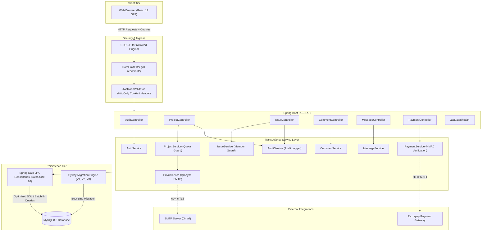
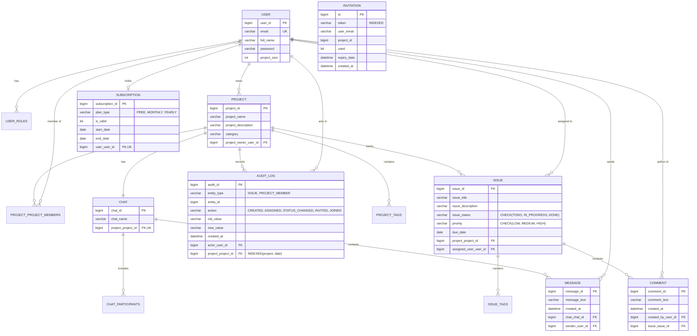
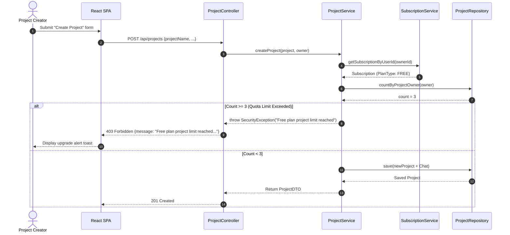
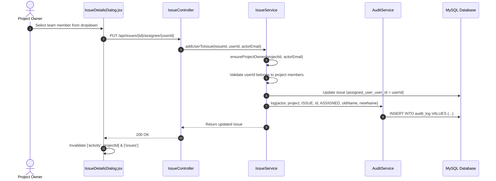

# SprintFlow — Project & Issue Tracker

> A production-minded, backend-focused full-stack project and issue tracking platform built with Spring Boot 3.5, Java 21, React 19, and MySQL 8.

[](https://openjdk.org/)
[](https://spring.io/projects/spring-boot)
[](https://react.dev/)
[](https://vitejs.dev/)
[](https://www.mysql.com/)
[](https://flywaydb.org/)
[]()

---

## 1. Project Overview

**SprintFlow** is a modular monolith project management application engineered to mirror core agile workflows: project workspace isolation, team email invitations, issue tracking across priorities and statuses, task assignment with boundary validation, issue discussion threads, real-time activity audit trails, and multi-tier subscription plans with payment verification.

### Problem It Solves
Many portfolio projects rely on superficial CRUD tutorials or disjointed microservice architectures that hide basic software engineering fundamentals. SprintFlow addresses real-world enterprise engineering concerns:
- **Relational Data Integrity**: Strict database-level check constraints and Flyway schema migrations.
- **Query Optimization**: Elimination of the Hibernate `HHH000104` in-memory pagination hazard and batch-fetching to prevent N+1 query loops.
- **Application Security**: Stateless JWTs delivered in HttpOnly cookies, IP sliding-window rate limiting, and imperative service-level multi-tenancy authorization checks.
- **Domain Business Rules**: Plan quota enforcement (e.g., free tier project limits) and HMAC-SHA256 payment signature verification.

### Intended Users
Engineering teams, project managers, and individual contributors seeking a lightweight, cohesive workspace to manage task lifecycles, team communication, and project audit trails.

---

## 2. Screenshots & Demo

> [!NOTE]
> SprintFlow is currently configured for local development and containerized Docker Compose deployment. A hosted cloud demo URL is not currently deployed.

The user interface follows a modern dashboard layout built with Tailwind CSS and Radix UI primitives. Placeholders for key views to be stored under `docs/screenshots/`:

| View | Target Screenshot | Description |
| :--- | :--- | :--- |
| **Dashboard** | `docs/screenshots/01-dashboard.png` | Project statistics, categorized distributions, and recent workspaces. |
| **Project Workspace** | `docs/screenshots/02-project-details.png` | Tabbed navigation for Issue Board, Team Chat, and Project Activity. |
| **Issue Management** | `docs/screenshots/03-issue-dialog.png` | Issue creation, status changes, and owner-gated member assignment dropdown. |
| **Audit Activity Feed** | `docs/screenshots/04-activity-feed.png` | Append-only event history with actor avatars, timestamps, and action badges. |
| **Subscription & Plans** | `docs/screenshots/05-subscription-plans.png` | Free vs. Monthly/Yearly tiers with Razorpay payment checkout integration. |

---

## 3. Key Features

### Authentication & Session Security
- **Secure Registration & Login**: Password hashing via BCrypt and JWT issuance.
- **HttpOnly Cookie Transport**: Tokens are encapsulated in `SameSite=Lax`, HttpOnly cookies (`sprintflow_jwt`), mitigating cross-site scripting (XSS) token theft.
- **Rate Limiting**: Sliding-window rate limiter (`RateLimitFilter`) restricting `/api/auth/**` to 20 requests/minute per client IP (HTTP 429).
- **Authentication State Hydration**: Frontend session recovery and profile synchronization via `/api/users/me`.

### Project Management & Domain Quotas
- **Workspace Isolation**: Projects group members, issues, tags, and chat rooms.
- **Server-Side Pagination & Filtering**: Category and tag filtering with paginated queries.
- **Free-Tier Project Quotas**: Users on the `FREE` plan are limited to creating 3 projects; attempts to exceed this throw a 403 `SecurityException` prompting an upgrade.
- **Team Invitations**: Asynchronous (`@Async`) SMTP invitation emails with 7-day expiration tokens, one-time acceptance validation, and multi-project invitation query isolation.

### Issue Tracking & Task Lifecycles
- **Issue Operations**: Create, view, update status, and delete issues within a project.
- **Strict Status & Priority Domains**: Statuses (`TODO`, `IN_PROGRESS`, `DONE`) and priorities (`LOW`, `MEDIUM`, `HIGH`) enforced at the DTO validation, service, and database schema layers.
- **Owner-Gated Assignment**: Only project owners can assign or unassign issues. The API validates that assignees belong to the project membership before assignment.
- **Issue Comments**: Nested comment threads restricted to project members, with author-only deletion permissions.

### Team Collaboration & Auditability
- **Project Team Chat**: Integrated chat room per project with chronological message ordering and auto-scrolling (5-second polling interval).
- **Append-Only Audit Log**: Every issue creation, status transition, assignment change, and team invitation is recorded in the `audit_log` table with before/after state snapshots.
- **Live Activity Feed**: Tab in project details presenting paginated audit history with human-readable summary narratives.

### Subscriptions & Payment Verification
- **Tiered Plans**: `FREE`, `MONTHLY`, and `YEARLY` subscriptions.
- **Payment Link Generation**: Razorpay integration creating checkout sessions with dynamic callback URLs.
- **Cryptographic Verification**: Plan upgrades require `POST /api/payments/verify` with HMAC-SHA256 signature verification matching order and payment IDs.

### Observability & API Hygiene
- **Health Probes**: Spring Boot Actuator exposing `/actuator/health`, `/actuator/info`, and `/actuator/metrics`.
- **OpenAPI / Swagger UI**: Interactive API documentation generated at `/swagger-ui.html`.
- **Standardized Error Envelope**: Uniform `ApiErrorResponse` schema across validation errors, authorization rejections, and runtime exceptions.

---

## 4. Tech Stack

| Layer | Technology | Version | Purpose |
| :--- | :--- | :--- | :--- |
| **Backend Framework** | Spring Boot | 3.5.4 | Application framework, DI container, and REST runtime |
| **Language** | Java | 21 (LTS) | Core backend programming language |
| **Security** | Spring Security & JJWT | 6.x / 0.12.7 | Filter-based authentication, method authorization, JWT handling |
| **Persistence** | Spring Data JPA / Hibernate | 3.5.4 | ORM, repository abstraction, entity lifecycle management |
| **Database** | MySQL | 8.0 | Primary relational database engine |
| **Database Migrations** | Flyway | 10.x | Version-controlled, reproducible SQL database migrations |
| **Object Mapping** | MapStruct | 1.5.5.Final | Compile-time entity-to-DTO conversion |
| **Observability** | Spring Boot Actuator | 3.5.4 | Health checks, application info, and metric endpoints |
| **API Documentation** | SpringDoc OpenAPI | 2.8.9 | Automated Swagger UI and OpenAPI 3.0 specification |
| **External Services** | JavaMail & Razorpay | 1.4.9 | SMTP invitation emails and payment link processing |
| **Frontend Framework** | React | 19.2.7 | Client-side reactive user interface |
| **Build Tool** | Vite | 8.1.3 | Fast frontend bundle compilation and development server |
| **Routing** | React Router | 7.18.1 | Client-side page navigation and protected route guards |
| **Server State** | TanStack React Query | 5.101.2 | Data fetching, asynchronous state caching, and invalidation |
| **Forms & Validation** | React Hook Form & Zod | 7.80 / 4.4 | Schema-driven form handling and client-side validation |
| **UI Components** | Radix UI & Tailwind CSS | 1.x / 3.4.0 | Accessible UI primitives and utility-first styling |
| **Icons & Feedback** | Lucide React & Sonner | 1.23 / 2.0.7 | UI iconography and toast notifications |
| **Testing** | JUnit 5, Mockito, Testcontainers, Vitest | 5.x / 5.0.0 | Backend unit/integration tests and frontend component tests |
| **Containerization** | Docker & Docker Compose | Multi-stage | Local development stack and production artifact packaging |

---

## 5. System Architecture

SprintFlow is engineered as a clean, modular monolith with distinct separation between controller contracts, transactional business services, JPA data access, and an autonomous React SPA.



### Architectural Decisions & Separation of Concerns
1. **Stateless Monolith with HttpOnly Cookies**: The backend maintains no in-memory session state. Authentication tokens are signed JWTs stored in browser cookies with `HttpOnly` and `SameSite=Lax` flags, preventing JavaScript access while maintaining CSRF resilience.
2. **Imperative Authorization Boundaries**: Rather than relying solely on global URL matchers, domain ownership and workspace memberships are checked imperatively via `ProjectService.ensureProjectOwner` and `ensureProjectMemberOrOwner`.
3. **Database-Level Enforced Schema Ownership**: Hibernate's schema auto-generation is set to `validate` (`spring.jpa.hibernate.ddl-auto=validate`). Schema changes occur exclusively through tracked Flyway SQL migration scripts.
4. **Batch-Optimized Data Fetching**: Paginated queries avoid eager collection loading to allow database-level SQL `LIMIT`/`OFFSET` pagination, with `@BatchSize(size = 20)` preventing N+1 child queries.

---

## 6. Project Structure

```
SprintFlow/
├── .github/
│   └── workflows/
│       └── ci.yml                     # Automated CI pipeline (Maven verify + Frontend test/build)
├── backend/
│   ├── src/
│   │   ├── main/
│   │   │   ├── java/com/sprintflow/
│   │   │   │   ├── config/            # Security filter chain, JWT validator, rate limiter, CORS
│   │   │   │   ├── controller/        # REST endpoints (Auth, Project, Issue, Comment, Chat, Payment)
│   │   │   │   ├── dto/               # Typed transfer records exposed to client
│   │   │   │   ├── entity/            # JPA entities (User, Project, Issue, AuditLog, etc.)
│   │   │   │   ├── exception/         # Custom exceptions & global @RestControllerAdvice handler
│   │   │   │   ├── mapper/            # MapStruct mappers (Entity <-> DTO)
│   │   │   │   ├── repository/        # Spring Data JPA repositories with batch/graph queries
│   │   │   │   ├── request/           # Incoming request DTOs with Bean Validation annotations
│   │   │   │   ├── response/          # Structured response bodies
│   │   │   │   └── service/           # Transactional business logic & boundary checks
│   │   │   └── resources/
│   │   │       ├── db/migration/      # Flyway SQL migrations (V1, V2, V3)
│   │   │       └── application.properties # Main Spring configuration & logging settings
│   │   └── test/java/com/sprintflow/  # Unit, MockMvc security, and Testcontainers test suites
│   ├── .env.example                   # Backend environment template
│   ├── Dockerfile                     # Multi-stage Eclipse Temurin Java 21 build
│   └── pom.xml                        # Maven dependency & compiler definitions
├── frontend/
│   ├── src/
│   │   ├── components/                # Reusable UI widgets, IssueList, ActivityFeed, Chat, Dialogs
│   │   │   └── ui/                    # Radix UI + Tailwind base elements (Card, Button, Dialog, etc.)
│   │   ├── contexts/                  # AuthContext (user state) & ThemeContext (dark/light mode)
│   │   ├── layouts/                   # MainLayout (with navbar) & AuthLayout (centered card)
│   │   ├── pages/                     # Routed pages (Dashboard, ProjectDetails, Subscription, etc.)
│   │   ├── routes/                    # AppRoutes definitions with ProtectedRoute guard
│   │   └── services/                  # Axios HTTP client with credentials and interceptors
│   ├── .env.example                   # Frontend environment template
│   ├── package.json                   # Dependencies, Vitest scripts, and Oxlint commands
│   └── vite.config.js                 # Vite bundler configuration
├── docs/
│   └── screenshots/                   # Application preview captures
├── docker-compose.yml                 # MySQL 8.0 database + Spring Boot API orchestration
└── README.md                          # Comprehensive project documentation
```

---

## 7. Database Design

SprintFlow's database schema is managed via Flyway migrations (`V1__initial_schema.sql`, `V2__issue_constraints.sql`, and `V3__audit_log.sql`).



### Key Database Constraints & Integrity Rules
- **Unique Constraints**: `user.email` is globally unique. `subscription.user_user_id` and `chat.project_project_id` enforce one-to-one mapping relationships.
- **Enumeration Check Constraints (`V2`)**: `issue.issue_status` is restricted to `('TODO', 'IN_PROGRESS', 'DONE')`. `issue.priority` is restricted to `('LOW', 'MEDIUM', 'HIGH')`.
- **Targeted Indexes**: `idx_invitation_token` on `invitation(token)`, `idx_message_chat` on `message(chat_chat_id)`, and `idx_audit_project` on `audit_log(project_project_id, created_at)` ensure predictable lookup performance.

---

## 8. API Documentation

Interactive OpenAPI documentation is hosted at `http://localhost:8080/swagger-ui.html`.

### Endpoints Inventory

| Method | Endpoint | Description | Authentication |
| :--- | :--- | :--- | :--- |
| `POST` | `/api/auth/register` | Register new user account & allocate free subscription | Public |
| `POST` | `/api/auth/login` | Authenticate credentials & return HttpOnly JWT cookie | Public |
| `POST` | `/api/auth/logout` | Invalidate authenticated session & clear cookie | Public |
| `GET` | `/api/users/me` | Fetch authenticated user's profile | Authenticated |
| `POST` | `/api/projects` | Create project (enforces 3-project free plan quota) | Authenticated |
| `GET` | `/api/projects` | List projects user owns or belongs to (paged, filters) | Authenticated |
| `GET` | `/api/projects/{projectId}` | Fetch single project workspace details | Member or Owner |
| `PUT` | `/api/projects/{projectId}` | Update project metadata | Project Owner |
| `DELETE` | `/api/projects/{projectId}` | Delete project and cascade child items | Project Owner |
| `GET` | `/api/projects/search` | Search accessible projects by name substring | Authenticated |
| `GET` | `/api/projects/{projectId}/chat` | Fetch chat metadata for a project | Member or Owner |
| `POST` | `/api/projects/invite` | Send email invitation to registered user | Project Owner |
| `GET` | `/api/projects/invite?token={token}` | Accept invitation and join project | Authenticated |
| `GET` | `/api/projects/{projectId}/activity` | Fetch paginated project audit log feed | Member or Owner |
| `POST` | `/api/issues` | Create new issue within a project | Member or Owner |
| `GET` | `/api/issues/{issueId}` | Fetch issue details | Member or Owner |
| `GET` | `/api/issues/project/{projectId}` | Fetch paginated issues for a project | Member or Owner |
| `PUT` | `/api/issues/{issueId}/assignee/{userId}` | Assign issue to project member | Project Owner |
| `DELETE` | `/api/issues/{issueId}/assignee` | Unassign issue | Project Owner |
| `PUT` | `/api/issues/{issueId}/status/{status}` | Update issue status (`TODO`/`IN_PROGRESS`/`DONE`) | Member or Owner |
| `DELETE` | `/api/issues/{issueId}` | Delete an issue | Member or Owner |
| `POST` | `/api/comments` | Add comment to an issue | Member or Owner |
| `GET` | `/api/comments/issue/{issueId}` | Fetch paginated comments for an issue | Member or Owner |
| `DELETE` | `/api/comments/{commentId}` | Delete comment | Comment Author |
| `POST` | `/api/messages/send` | Post message to project chat | Member or Owner |
| `GET` | `/api/messages/chat/{projectId}` | Fetch chat message history (chronological, paged) | Member or Owner |
| `POST` | `/api/payments/{planType}` | Generate Razorpay payment link | Authenticated |
| `POST` | `/api/payments/verify` | Verify payment signature & upgrade plan | Authenticated |
| `GET` | `/api/subscriptions/user` | Fetch current subscription details | Authenticated |
| `GET` | `/actuator/health` | Application health and component readiness | Public |

### Request & Response Examples

#### 1. Register User (`POST /api/auth/register`)
**Request Body:**
```json
{
  "fullName": "Jane Doe",
  "email": "jane@example.com",
  "password": "SecurePassword123!"
}
```
**Response (`201 Created`):**
Sets response cookie `sprintflow_jwt=<jwt_token>; Path=/; HttpOnly; SameSite=Lax`.

#### 2. Create Project (`POST /api/projects`)
**Request Body:**
```json
{
  "projectName": "Mobile App V2",
  "projectDescription": "Redesign of mobile customer onboarding",
  "category": "Mobile",
  "tags": ["react-native", "release-q3"]
}
```
**Response (`201 Created`):**
```json
{
  "projectId": 12,
  "projectName": "Mobile App V2",
  "projectDescription": "Redesign of mobile customer onboarding",
  "category": "Mobile",
  "tags": ["react-native", "release-q3"],
  "projectOwner": {
    "id": 1,
    "fullName": "Jane Doe",
    "email": "jane@example.com"
  },
  "projectMembers": [
    {
      "id": 1,
      "fullName": "Jane Doe",
      "email": "jane@example.com"
    }
  ]
}
```

#### 3. Standard Error Envelope (`403 Forbidden` / `400 Bad Request`)
```json
{
  "status": 403,
  "error": "Forbidden",
  "message": "Free plan project limit (3 projects) reached. Please upgrade to create more projects.",
  "path": "/api/projects"
}
```

---

## 9. Installation & Setup

### Prerequisites
- **Java Development Kit (JDK)**: Version 21 (LTS)
- **Apache Maven**: Version 3.9+
- **Node.js**: Version 22+ (LTS) and `npm`
- **Database Engine**: MySQL 8.0 (or Docker)

### Option A: Quickstart via Docker Compose (Recommended)
This starts MySQL 8.0 (port 3307 on host, 3306 internally) and the backend API container.

```bash
# 1. Clone repository
git clone https://github.com/Shailesh-github3/SprintFlow.git
cd SprintFlow

# 2. Configure environment files
cp backend/.env.example backend/.env
cp frontend/.env.example frontend/.env

# 3. Start database and backend services
docker compose up --build -d

# 4. Start frontend development server
cd frontend
npm install
npm run dev
```

Access the frontend at `http://localhost:5173`, the backend API at `http://localhost:8080`, and Swagger at `http://localhost:8080/swagger-ui.html`.

---

### Option B: Local Native Development

#### 1. Database Setup
Create an empty MySQL database:
```sql
CREATE DATABASE sprintflow CHARACTER SET utf8mb4 COLLATE utf8mb4_unicode_ci;
```

#### 2. Backend Setup
Configure `backend/.env` (or set system environment variables):
```properties
SPRING_DATASOURCE_URL=jdbc:mysql://localhost:3306/sprintflow
SPRING_DATASOURCE_USERNAME=root
SPRING_DATASOURCE_PASSWORD=your_password
SPRINGFLOW_JWT_SECRET=4a72d3f9b8e1a5c6d2e4f7a8b9c0d1e2f3a4b5c6d7e8f9a0b1c2d3e4f5a6b7c8
```

Run the backend via Maven (Flyway will automatically execute migrations on startup):
```bash
cd backend
mvn spring-boot:run
```

#### 3. Frontend Setup
```bash
cd frontend
npm install
npm run dev
```

### Environment Variable Reference

#### Backend (`backend/.env`)
| Variable | Purpose | Verified Example |
| :--- | :--- | :--- |
| `SPRING_DATASOURCE_URL` | JDBC connection string | `jdbc:mysql://localhost:3306/sprintflow` |
| `SPRING_DATASOURCE_USERNAME` | Database username | `root` |
| `SPRING_DATASOURCE_PASSWORD` | Database password | `<your-db-password>` |
| `SPRINGFLOW_JWT_SECRET` | 32+ byte HMAC-SHA secret for token signing | `<64-hex-character-secret>` |
| `SPRINGFLOW_JWT_EXPIRATION_MS`| JWT validity duration in milliseconds | `86400000` (24 hours) |
| `SPRINGFLOW_CORS_ALLOWED_ORIGINS`| Allowed origins for CORS credentials | `http://localhost:5173` |
| `SPRINGFLOW_FRONTEND_URL` | Base frontend URL for email invitation links | `http://localhost:5173` |
| `SPRING_MAIL_HOST` | SMTP server hostname | `smtp.gmail.com` |
| `SPRING_MAIL_PORT` | SMTP port | `587` |
| `SPRING_MAIL_USERNAME` | SMTP sender email address | `noreply.sprintflow@gmail.com` |
| `SPRING_MAIL_PASSWORD` | SMTP app-specific password | `<app-password>` |
| `RAZORPAY_KEY_ID` | Razorpay API key identifier | `rzp_test_...` (optional for local dev) |
| `RAZORPAY_KEY_SECRET` | Razorpay API key secret | `<secret>` (optional for local dev) |

#### Frontend (`frontend/.env`)
| Variable | Purpose | Verified Example |
| :--- | :--- | :--- |
| `VITE_API_URL` | Base URL of the backend REST API | `http://localhost:8080` |

---

## 10. Application Workflows

### 1. Authentication & Cookie Session Flow
```mermaid
sequenceDiagram
    autonumber
    actor User
    participant React as React SPA (Login.jsx)
    participant AuthCtrl as AuthController
    participant UserRepo as UserRepository
    participant PasswordEnc as PasswordEncoder
    participant JwtProv as JwtProvider

    User->>React: Enter credentials and submit
    React->>AuthCtrl: POST /api/auth/login (email, password)
    AuthCtrl->>UserRepo: findByEmail(email)
    UserRepo-->>AuthCtrl: User entity with BCrypt hash
    AuthCtrl->>PasswordEnc: matches(rawPassword, hashedPassword)
    PasswordEnc-->>AuthCtrl: Match confirmed (true)
    AuthCtrl->>JwtProv: generateToken(Authentication)
    JwtProv-->>AuthCtrl: Signed JWT token string
    AuthCtrl-->>React: 200 OK + Set-Cookie header
    Note over React,AuthCtrl: Cookie: sprintflow_jwt=...<br/>HttpOnly; SameSite=Lax
    React->>React: Set isAuthenticated = true
    React->>React: Navigate to Dashboard
```

### 2. Project Creation & Plan Quota Enforcement


### 3. Issue Assignment & Audit Logging


---

## 11. Security Implementation

- **Password Hashing**: Implemented via Spring Security's `BCryptPasswordEncoder` (strength 10).
- **Stateless Session Transport**: JWTs are stored in HttpOnly cookies with `SameSite=Lax`, rendering tokens inaccessible to malicious scripts running in the document context.
- **Brute-Force Rate Limiting**: `RateLimitFilter` enforces a 20 request/minute/IP sliding window specifically covering `/api/auth/register` and `/api/auth/login`. Exceeding limits returns HTTP 429 with standard headers.
- **Method Security**: All application endpoints under `/api/**` mandate `@PreAuthorize("isAuthenticated()")` with role checking.
- **Multi-Tenancy Guarding**:
  - `ensureProjectOwner`: Verifies the caller's email matches `project.projectOwner.email`.
  - `ensureProjectMemberOrOwner`: Verifies the caller is either the owner or present in `project.projectMembers`.
  - `InvitationRepository.findByUserEmailAndProjectId`: Prevents invitation collisions when a single email is invited across multiple separate workspaces.
- **Cryptographic Payment Integrity**: `PaymentService.completePayment` verifies the Razorpay signature via `HmacSHA256(orderId + "|" + paymentId, apiSecret)` before modifying user plan tiers.
- **Sanitized Error Responses**: `GlobalExceptionHandler` masks database and internal server errors, returning clean JSON payloads that prevent SQL injection error probing and user enumeration.

---

## 12. Testing

The repository contains automated unit and integration tests across both backend and frontend tiers.

### Test Execution Commands

```bash
# Execute full backend test suite
cd backend
mvn test

# Execute targeted controller authorization tests
mvn test "-Dtest=ProjectControllerAuthorizationTest,IssueControllerAuthorizationTest"

# Execute frontend Vitest tests
cd frontend
npm test

# Run frontend linting verification
npm run lint
```

### Verified Test Coverage
- **Backend (81 Tests, 100% Pass Rate)**:
  - `SprintflowApplicationTests`: Full Spring context boot and bean initialization.
  - `AuthControllerSecurityTest`: Registration, login validation, duplicate handling (409), invalid credentials (401).
  - `ProjectControllerAuthorizationTest` & `IssueControllerAuthorizationTest`: RBAC and multi-tenancy boundary authorization.
  - `ProjectServiceUnitTest`: Project ownership assertions, chat provisioning, and free-plan quota limit boundary tests.
  - `IssueServiceAuditTest`: Member validation on assignment, unassignment workflows, and audit logging events.
  - `PaymentServiceTest`: HMAC-SHA256 signature verification, parameter validation, and subscription updates.
  - `RateLimitFilterTest`: IP sliding window verification and 429 status enforcement.
  - `RepositoryIntegrationTest`: Validates JPA batch fetching and relationship mappings with Testcontainers MySQL (gracefully skipped if Docker daemon is offline).
- **Frontend (5 Vitest Tests)**:
  - `IssueForm.test.jsx`: Validates title length constraints and enum priority/status submissions.
  - `Login.test.jsx`: Validates email format validation without triggering superfluous network requests.
  - `ConfirmDialog.test.jsx`: Confirms dialog visibility and callback execution.

---

## 13. Deployment

### Containerized Deployment
SprintFlow includes a production-ready, multi-stage `backend/Dockerfile` that builds the artifact on `maven:3.9-eclipse-temurin-21` and executes the packaged `.jar` on a hardened `eclipse-temurin:21-jre` runtime image.

The `docker-compose.yml` file configures:
- **MySQL 8.0**: Healthcheck probes via `mysqladmin ping` ensuring the database is fully initialized prior to API container boot.
- **Spring Boot API**: Automatic Flyway migration execution during container boot.

### Continuous Integration (GitHub Actions)
The workflow `.github/workflows/ci.yml` executes on every push and pull request:
1. Provisions a dedicated MySQL 8.0 service container.
2. Compiles backend source and executes `mvn -B verify` against the real database.
3. Sets up Node.js 22, performs `npm ci`, runs `oxlint`, executes `npm test`, and validates production bundling via `npm run build`.

---

## 14. Deliberate Trade-Offs & Future Work

SprintFlow was built as a clean, defendable modular monolith. The following architectural trade-offs are intentional:

1. **Polling vs. WebSockets for Chat**: Project chat uses 5-second polling rather than WebSockets/STOMP. This keeps the application completely stateless, eliminating the need for sticky load-balancer sessions, stateful socket threads, or Redis pub/sub brokers.
2. **In-Memory Rate Limiting**: The sliding-window rate limiter resides in local memory. In a distributed multi-instance deployment behind a round-robin load balancer, this would be replaced with Redis token-bucket rate limiting.
3. **Webhook Verification**: Payment verification currently occurs synchronously via client redirect to `/api/payments/verify`. Implementing an asynchronous server-to-server Razorpay webhook handler would provide resilience against browser drop-off during redirects.
4. **No Unjustified Microservices**: Core features (projects, issues, comments, chat, subscriptions) share a single relational database rather than being divided into separate microservice boundaries with distributed transactions.

---

## 15. License

No license has been specified for this project. All rights are reserved by the repository owner.
